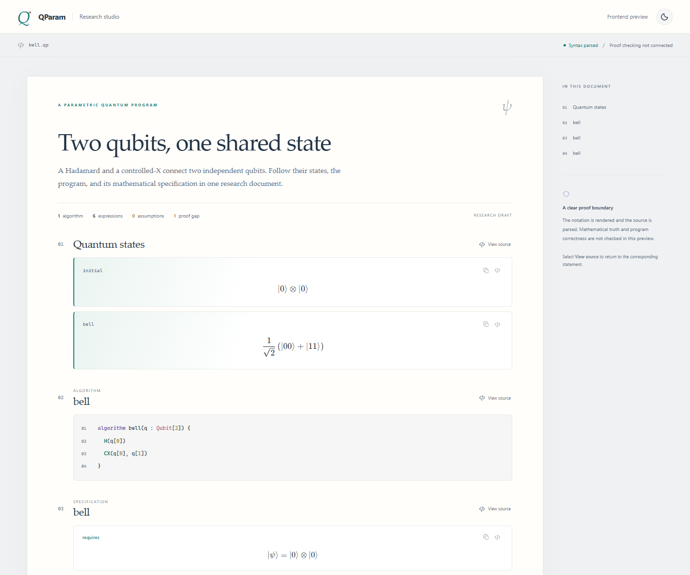

# QParam Studio

**Quantum algorithms, written as mathematics.**

QAlgLean is developing QP, a parametric quantum programming language with its own
quantum proof kernel and an explicit interface to Lean. This first release is the
**QParam Studio** frontend: a VS Code language extension and a live, typeset paper
view. Write quantum states, programs, specifications, assumptions, and proof goals
in one `.qp` research document.



## Try it in VS Code

You need Node.js 22 or newer and desktop VS Code 1.95 or newer.

```sh
git clone https://github.com/yezhuoyang/QAlgLean.git
cd QAlgLean
npm ci
code .
```

Press **F5** and select **Explore QParam**. The extension builds and opens the Bell
example in a separate Extension Development Host. In that window, use the editor's
**Open Paper Preview** button, or run **QParam: Open Paper Preview** from the command
palette. The shortcut is **Ctrl+K V** (macOS: **Cmd+K V**).

For a normal installation:

```sh
npm run package
code --install-extension artifacts/qparam-studio-0.1.0.vsix
```

Then run **QParam: Open an Example**. It opens an editable, unsaved copy, so you can
experiment freely and save your own `.qp` file. The optional **QParam Midnight**
color theme gives source code its own quantum/mathematical palette; select it with
**Preferences: Color Theme**. The paper view has an independent light/dark toggle.

## Write a state as it appears in a paper

```qp
qparam FourierNotebook
title "The geometry of a Fourier state"
parameter n : Nat
assume positive : $n \ge 1$

state zero := $\bigotimes_{j=0}^{n-1}\ket{0}$
state uniform := $\frac{1}{\sqrt{2^n}}\sum_{x=0}^{2^n-1}\ket{x}$

algorithm prepare(q : Qubit[n]) {
  repeat j in 0..n {
    H(q[j])
  }
}

spec prepare {
  requires $\ket{\psi} = \bigotimes_{j=0}^{n-1}\ket{0}$
  ensures $\ket{\psi} = \frac{1}{\sqrt{2^n}}\sum_{x=0}^{2^n-1}\ket{x}$
  costs $G = n$
}
```

The source stays editable text; the adjacent paper view displays real mathematical
typesetting, including fractions, indexed sums, tensor products, bras, kets, and
complex phases. Click **View source** beside a formula to return to its source.

- Type **`$sum`**, **`$ket`**, **`$tensor`**, or **`$alpha`**, then accept a completion.
  The completion inserts a balanced `$…$` formula. Tab moves between its fields.
- Inside a formula, use **`\sum`**, **`\ket`**, and the other backslash completions.
- Use **QParam: Insert Mathematical Notation** for a searchable symbol palette.
- Use the contributed snippets for complete documents, states, tensors,
  specifications, assumptions, and proof outlines.
- The Outline view lists declarations; syntax errors appear in the Problems panel.

The [language reference](docs/language.md) defines the grammar, mathematical syntax
tree, precedence, supported commands, and current limitations. Examples include
[Bell preparation](examples/bell.qp) and a [Fourier state notebook](examples/fourier.qp).

## LaTeX exchange

**QParam: Export Paper to LaTeX** creates a standalone `.tex` document for XeLaTeX
or LuaLaTeX, preserving Unicode mathematics, from a syntactically valid `.qp` file.
**QParam: Import QParam Block from LaTeX** opens an
editable QParam document from exactly one explicit source environment:

```tex
\begin{qparam}
qparam Example
state plus := $\frac{1}{\sqrt{2}}(\ket{0}+\ket{1})$
\end{qparam}
```

Open [paper-import.tex](examples/paper-import.tex) and run the import command to try
it. Mathematical LaTeX in these blocks has a defined parser. General TeX macros,
arbitrary paper prose, and TeX execution are not supported. Paper export is a
typeset presentation; it is not a lossless source archive for reimport.

## What this release establishes

This is an **authoring prototype, not a quantum verifier**. The frontend parses a
defined document grammar and mathematical AST, reports syntax errors, and renders
the same source. It does not yet type-check quantum states, execute algorithms,
check Hoare proofs, verify cost claims, or invoke Lean. `costs` fields are authored
claims. `by lean "..."` is an unresolved reference. `admit` is an open proof gap.

The interface keeps named assumptions and missing proofs visible. A successful
parse is never presented as a correctness certificate. The intended separation
between the frontend, future QP kernel, and Lean is described in
[the architecture reference](docs/architecture.md).

## Development

```sh
npm test                # Build and run syntax, export, and rendering tests
npm run test:extension  # Exercise the extension in a real, isolated VS Code host
npm run package         # Build an installable VSIX, including local math fonts
npm run preview         # Inspect the same paper renderer at http://127.0.0.1:4173
```

The extension-host runner uses the standard Windows installation when available;
set `VSCODE_EXECUTABLE` to another installation, or let it download VS Code. The
browser preview is a local visual-development tool, not a second language editor.

| Path | Purpose |
|---|---|
| `src/language/` | Document parser and mathematical syntax tree |
| `src/editor/` | Notation palette and explicit LaTeX exchange |
| `src/preview/`, `media/` | Paper renderer, interaction, and styling |
| `src/extension.ts` | VS Code integration, diagnostics, and commands |
| `syntaxes/`, `snippets/`, `themes/` | Source highlighting and authoring assets |
| `examples/` | Small, explicitly unverified research documents |
| `test/` | Parser and integration regression tests |

Math rendering uses bundled KaTeX and fonts; it needs no CDN or network access.
Document content is not executed. KaTeX's MIT license is included with packaged
assets. QAlgLean is licensed under [Apache-2.0](LICENSE).
