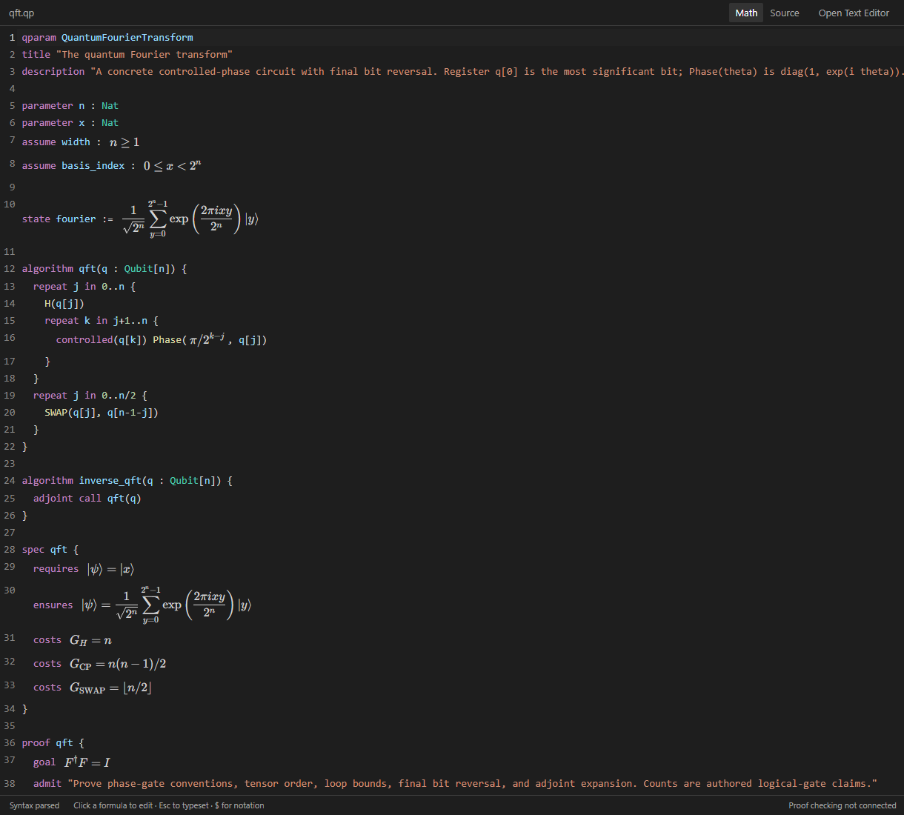

# QParam

**Quantum programs and specifications, written as mathematics.**

Open a `.qp` file in VS Code: sums, kets, tensor products, matrices, and assertions
are typeset **inside the editor**, alongside highlighted language keywords. Click a
formula to edit its LaTeX. Move the cursor away, or press Escape, to typeset it again.
No separate preview is required.

A parametric program and its specification can read like this:

$$
\begin{array}{ll}
\mathbf{algorithm} & \mathtt{uniform}(q : \mathrm{Qubit}[n]) \\[3pt]
 & \mathbf{repeat}\; j \in [0,n):\quad H(q_j) \\[9pt]
\mathbf{requires} & |\psi\rangle = \displaystyle\bigotimes_{j=0}^{n-1}|0\rangle \\[9pt]
\mathbf{ensures} & |\psi\rangle = \displaystyle\frac{1}{\sqrt{2^n}}\sum_{y=0}^{2^n-1}|y\rangle \\[9pt]
\mathbf{costs} & G=n
\end{array}
$$

This is a typeset presentation of [uniform preparation](examples/fourier.qp).
Its `.qp` source is ordinary text:

```qp
algorithm uniform(q : Qubit[n]) {
  repeat j in 0..n {
    H(q[j])
  }
}

spec uniform {
  requires $\ket{\psi} = \bigotimes_{j=0}^{n-1}\ket{0}$
  ensures $\ket{\psi} = \frac{1}{\sqrt{2^{n}}}\sum_{y=0}^{2^{n}-1}\ket{y}$
  costs $G=n$
}
```

## Mathematics in the file



The interface follows your VS Code theme: line numbers, a source editor, and
mathematics. **Math / Source** switches presentation without changing the file.
**Open Text Editor** returns to VS Code's ordinary text editor. Save, undo, redo,
and Git operate on the underlying `.qp` source.

- Type **`$sum`**, **`$ket`**, **`$tensor`**, or **`$matrix`** and accept a completion.
- Inside mathematics, type **`\`** for the notation palette, including Greek letters,
  operators, Dirac notation, matrices, integrals, and asymptotic bounds.
- Click a formula or move the cursor into it to edit. Tab moves between snippet fields.
- Syntax issues appear in the editor and VS Code's Problems panel.
- Use **QParam: Open Paper Preview** for a compact reading view, or export to LaTeX.

## From Fourier transforms to operator contracts

The [QFT example](examples/qft.qp) contains indexed controlled-phase gates, final
bit reversal, an adjoint call, and the intended Fourier-state specification:

$$
\begin{aligned}
\mathbf{requires}\quad &|\psi\rangle=|x\rangle,\qquad 0\le x<2^n,\\[4pt]
\mathbf{ensures}\quad &|\psi\rangle=\frac{1}{\sqrt{2^n}}
\sum_{y=0}^{2^n-1}e^{2\pi ixy/2^n}|y\rangle,\\[4pt]
\mathbf{costs}\quad &G_H=n,\qquad G_{\mathrm{CP}}=\frac{n(n-1)}{2}.
\end{aligned}
$$

Assertions can also express an approximate block encoding and Hamiltonian evolution:

$$
\left\|A-\alpha(\langle0|^{\otimes a}\otimes I)U
(|0\rangle^{\otimes a}\otimes I)\right\|\le\varepsilon,
\qquad
\left\|V-e^{-itH}\right\|\le\delta.
$$

The core circuit syntax records parametric register sizes, arithmetic loop bounds,
register slices, gates with mathematical angles, reusable calls, controlled and
adjoint operations, measurement, and explicitly declared external oracles. See the
[language reference](docs/language.md) and [mathematical syntax reference](docs/math-support.md).

| Example | Included today |
|---|---|
| [Bell pair](examples/bell.qp), [uniform superposition](examples/fourier.qp) | Concrete gate circuits, state formulas and specifications |
| [Deutsch–Jozsa](examples/deutsch-jozsa.qp), [Bernstein–Vazirani](examples/bernstein-vazirani.qp) | Query circuits with explicit oracle contracts |
| [Grover](examples/grover.qp) | Parametric iterations, a gate-level diffuser, and a success-probability claim |
| [QFT](examples/qft.qp) | Controlled phases, bit reversal, inverse via an adjoint call |
| [Shor order finding](examples/shor-order-finding.qp) | Circuit skeleton; modular arithmetic and inverse QFT are explicit external components |
| [Hamiltonian simulation / block encoding](examples/hamiltonian-block-encoding.qp) | Operator interfaces, matrix notation, approximation and resource obligations |
| [LWE research obligations](examples/lwe-obligations.qp) | Modular/lattice/Gaussian notation and open obligations; no claimed reconstruction of Chen's algorithm |

These examples exercise a defined, extensible mathematical grammar. They are **not
complete implementations or verifications of every algorithm family**. The
[coverage guide](docs/algorithm-coverage.md) identifies the implementation and proof
gaps, including the limits of the Chen example.

## Try it in VS Code

You need Node.js 22 or newer and desktop VS Code 1.95 or newer.

```sh
git clone https://github.com/yezhuoyang/QAlgLean.git
cd QAlgLean
npm ci
npm run package
code --install-extension artifacts/qparam-studio-0.2.0.vsix
code examples/qft.qp
```

Run **QParam: Open an Example** for an editable, unsaved copy from the gallery.
If an existing tab still uses the ordinary source editor, select **QParam: Open
Mathematical Editor**, or **Reopen Editor With → QParam Mathematical Editor**.

For extension development, open the repository in VS Code and press **F5** with
**Explore QParam** selected. No custom color theme or network service is needed.

## LaTeX and the checking boundary

**QParam: Export Paper to LaTeX** exports a syntactically valid document for XeLaTeX
or LuaLaTeX. **QParam: Import QParam Block from LaTeX** extracts one explicit
`qparam` environment, as in [paper-import.tex](examples/paper-import.tex).
Assertions use a parsed subset of mathematical LaTeX with a shared fixed macro
library. Importing arbitrary papers, executing TeX, and arbitrary macro definitions
are outside this frontend's scope.

QP is intended to have an independent quantum proof kernel and an explicit Lean
interface. **This release is an authoring frontend:** it parses mathematical and
circuit syntax, but does not yet type-check or execute circuits, verify proofs,
compute resource estimates, or invoke Lean. Specifications and `costs` are authored
claims; `assume` is a premise, `admit` an open obligation, and `by lean` an unresolved
reference. See [architecture and trust boundary](docs/architecture.md).

## Development

```sh
npm test                # Parser, mathematical coverage, rendering, editing protocol
npm run test:extension  # Real VS Code: opening .qp, saving, undo/redo, source view
npm run package         # Installable VSIX with bundled math fonts and editor
npm run preview         # /editor?example=qft for editor QA; / for reading view
```

| Path | Purpose |
|---|---|
| `src/language/` | Document/circuit AST, mathematical AST, shared notation registry |
| `src/editor/` | Mathematical editor, versioned text edits, completions, LaTeX exchange |
| `src/preview/`, `media/` | Reading view, editor styles, bundled browser assets |
| `src/extension.ts` | VS Code registration, diagnostics, gallery, commands |
| `syntaxes/`, `snippets/` | Ordinary text editor highlighting and snippets |
| `examples/`, `test/` | Algorithm documents and regression coverage |

The repository is QAlgLean; the extension is QParam Studio (`yezhuoyang.qparam-studio`).
Rendering uses local KaTeX and CodeMirror assets. QAlgLean is licensed under
[Apache-2.0](LICENSE); bundled dependency licenses are included in the extension.
